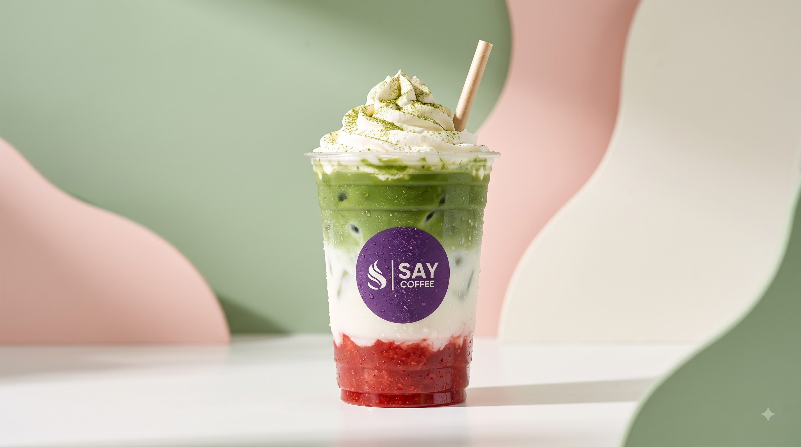

# ☕ Say Coffee — Laxmi Nagar

An optimized, high-end cafe eCommerce web application for **Say Coffee Laxmi Nagar**, crafted with a modern, minimalist-yet-immersive design system inspired by Starbucks app ergonomics and clean editorial aesthetics.



---

## 🌟 Key Features

### 1. 🎯 Sticky eCommerce Navbar
- Centered brand typography with highlighted **Laxmi Nagar** location badge.
- Live dynamic Cart counter badge that bounces upon item addition.
- Direct phone hotline to `9990940010`.

### 2. 🧋 Immersive Starbucks App-Style Hero Carousel
- **Matcha Strawberry Fusion** (Exact text: *'Matcha Strawberry'*, ₹164) with Sage Green & Blush Pink dynamic ambient glow.
- **Roasted Hazelnut Frappe** (Exact text: *'Roasted Hazelnut'*, ₹134) with Warm Caramel Amber glow.
- **Vietnamese Cold Coffee** (Exact text: *'Vietnamese Cold Coffee'*, ₹148) with Royal Purple & Espresso Gold glow.
- Seamless 5-second auto-rotation, touch-swipe support for mobile, and one-click direct cart addition.

### 3. 🍽️ Interactive Menu Grid
- Clean category filter navigation across 11 authentic categories:
  - *Hot Coffee, Cold Coffee, Matcha & Refreshers, Handcrafted Fries, Burgers, Mexican Quesadillas & Burritos, Artisan Pizza, Wraps & Pita Pockets, Sandwiches & Salads, Thick Shakes & Waffles, Artisan Chai.*
- Real-time search filter and Veg Only (🟢) / Non-Veg (🔴) toggles.
- Every card is fully interactive and customizable.

### 4. ⚙️ Dynamic Item Customization Modal
- Dynamic add-ons and selectors:
  - **Matcha, Shakes & Fries:** Mandatory Large Size Upgrade (+₹49).
  - **Burgers:** Add Cheese Slice (+₹20), Extra Patty (+₹45), Special Dip (+₹25).
  - **Coffee:** Flavor syrups (Hazelnut, Caramel, Vanilla +₹30), Extra Espresso Shot (+₹50), Vanilla Ice-cream Scoop (+₹40), Plant Milks (Oat Milk, Almond Milk +₹45).
- **Live Real-Time Price Recalculation:** Dynamic CTA button displaying `Confirm & Add ₹X`.

### 5. 🛒 Slide-Over Cart Drawer & WhatsApp Checkout
- Full-height offcanvas cart with line items, modifier tags, and dynamic `+` / `-` quantity selectors.
- Delivery & dining preference (*Home Delivery / Takeaway / Dine-in*).
- **Massive Emerald Green WhatsApp Button:** Pre-formats a structured order ticket and opens directly to `9990940010`.

### 6. 📍 Localized Hub & FAQ
- Interactive accordion FAQ.
- Localized Laxmi Nagar vector map placeholder highlighting Metro Gate 2, Vikas Marg, and V3S Mall with direct Google Maps directions.

---

## 🚀 Running Locally

You can run the built-in Windows PowerShell local server:
```powershell
powershell -ExecutionPolicy Bypass -File .\server.ps1 -Port 8080
```
Then visit **`http://localhost:8080`** in your browser.

Or simply open `index.html` directly in any web browser.

---

## 🎨 Color Palette & Typography
- **Primary:** Royal Purple (`#5B2C84`)
- **Background:** Warm Minimalist Cream (`#FAF7F2`)
- **Accents:** Vanilla Cream, Blush Pink, Sage Green
- **Checkout Emerald:** `#25D366` / `#128C7E`
- **Fonts:** [Outfit](https://fonts.google.com/specimen/Outfit) & [Playfair Display](https://fonts.google.com/specimen/Playfair+Display)
